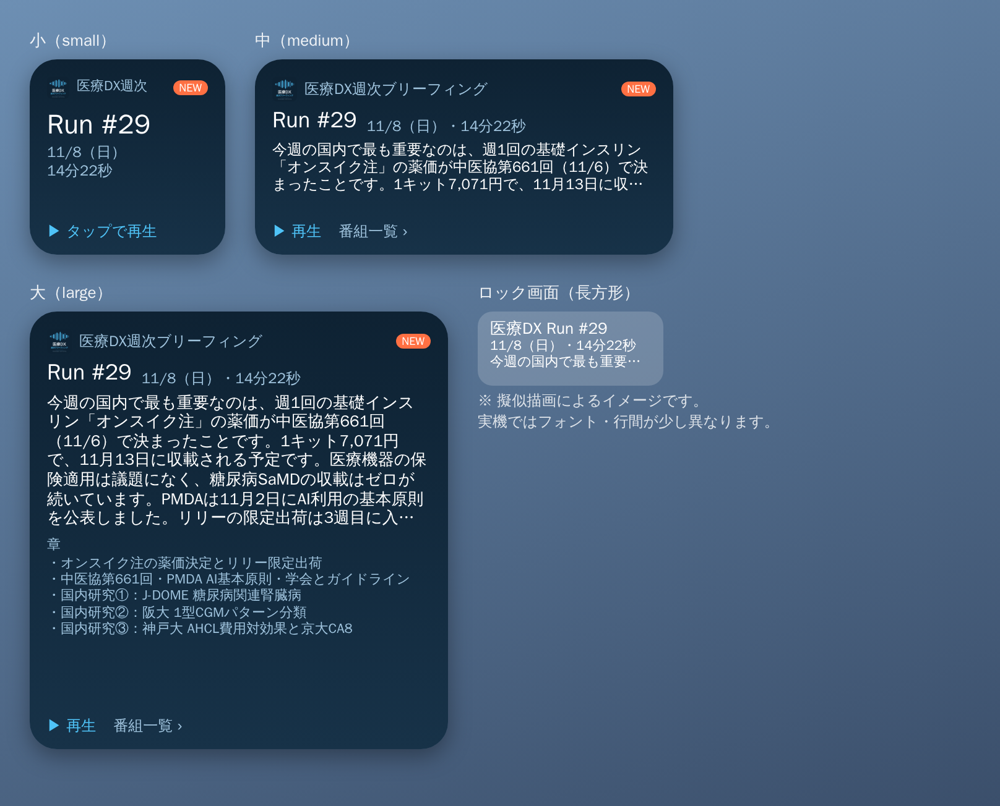

# 医療DX週次ブリーフィング iPhoneウィジェット

最新回の「回数・日付・尺・要約・章」をホーム画面/ロック画面に表示し、タップで音声を再生します。
無料アプリ **Scriptable**（JavaScriptでウィジェットを作れるアプリ）を使います。Mac・Xcode・開発者登録は不要です。



> ※ プレビューは擬似描画のイメージです。実機ではフォント・行間が少し異なります。

## 仕組み（ざっくり）

- ウィジェットが GitHub Pages の `podcast.xml`（番組フィード＝Podcastアプリ用の番組表）を読みに行きます。
- 毎週の配信更新（`podcast.xml` の更新）だけで自動的に最新回に切り替わります。**配信パイプライン側の変更は不要**です。
- 通信できないときは、前回取得した内容を「オフライン表示」として出します。
- 更新タイミングは iOS が決めます（目安：数時間ごと）。

## セットアップ（約3分）

1. App Store で **Scriptable** をインストール（無料）
2. Scriptable を開き、右上の **＋** で新しいスクリプトを作成
3. 下の「取り込み用コード」を貼り付けて、右下の **▶（実行）** を1回押す
   → スクリプト一覧に **「医療DXウィジェット」** が追加されます（この取り込み用スクリプトは削除してOK）
4. ホーム画面を長押し → 左上の **＋** → **Scriptable** を選び、好きなサイズ（小・中・大）を追加
5. 追加したウィジェットを長押し → **ウィジェットを編集** → **Script** で「医療DXウィジェット」を選ぶ

### 取り込み用コード（最初の1回だけ実行）

```js
// 医療DXウィジェット本体をGitHubから取り込んで、Scriptableに保存する
const url = "https://raw.githubusercontent.com/mkkitazawa1105-hue/dx-weekly-audio/claude/elegant-turing-gnltdb/widget/dx_weekly_widget.js";
const code = await new Request(url).loadString();
let fm; try { fm = FileManager.iCloud(); fm.documentsDirectory(); } catch (e) { fm = FileManager.local(); }
fm.writeString(fm.joinPath(fm.documentsDirectory(), "医療DXウィジェット.js"), code);
const a = new Alert(); a.title = "取り込み完了"; a.message = "一覧に「医療DXウィジェット」が追加されました"; a.addAction("OK"); await a.present();
```

> ブランチを main に統合（merge）した後は、URL中の `claude/elegant-turing-gnltdb` を `main` に読み替えてください。
> うまくいかない場合は、`dx_weekly_widget.js` の中身をそのまま新規スクリプトに貼り付けても動きます。

## ロック画面に置く場合（iOS 16以降）

ロック画面を長押し → **カスタマイズ** → **ロック画面** → ウィジェット欄をタップ → **Scriptable** → 長方形/円形/1行のいずれかを選び、Script に「医療DXウィジェット」を指定。

## オプション（ウィジェットの Parameter 欄）

| 入力 | タップしたときの動作 |
|------|------|
| （空欄） | 最新回の音声を再生（Safariで開く） |
| `page` | 番組一覧ページを開く |

中・大サイズでは、下部の「▶ 再生」「番組一覧 ›」をそれぞれ個別にタップできます。

## ファイル

| ファイル | 内容 |
|------|------|
| `dx_weekly_widget.js` | ウィジェット本体（Scriptable用） |
| `preview.png` | 見た目のイメージ |
